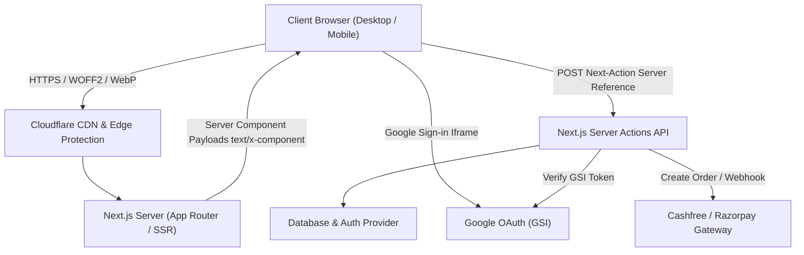

# G4Gate System Architecture & Reconnaissance Overview

**Target:** `https://g4gate.com/`  
**Analysis Date:** 2026-10-28  
**Analysis Engine:** Reverse-Engineer-Anything (REA) Chrome DevTools Protocol (CDP) Provider & Headless Browser Runtime  
**REA Evidence IDs:**
- `ev_5c0abb26bdb74718c68aab15d8dcc9b89eb2ef5e9080c8dee583552d6b9ff85d` (`list_browser_targets`)
- `ev_70aa1a83401fc1bce36fe794bc9937bfdcd83357bf1745c2f32585a9c07e3fc6` (`inspect_web_page` on `/login`)
- `ev_b45f74f6c6a8269dc7b585a2d3a4e3fc880941ba244bfd2404c69bd88dc2dbc9` (`capture_web_screenshot` on `/login`)
- `ev_9941d995703f06d43df89e113a72bf13f023bfa5ed3c9eda8576c5289f1519fe` (`list_browser_targets` multi-tab)
- `ev_3cfa17566038a86842ddc3dff166d65dacf94abb88a9ce511a6f94bc627de968` (`inspect_web_event_listeners`)

---

## 1. Executive Summary

G4Gate (`https://g4gate.com`) is an exam tracking and study ecosystem designed specifically for GATE (Graduate Aptitude Test in Engineering) and Data Structures & Algorithms (DSA) aspirants in India.

The platform provides a suite of study and preparation utilities, including:
- Syllabus progress tracking
- Test series attempt analytics
- Daily task management & to-do tracking
- Pomodoro focus timer with subject logging
- GATE scientific calculator replica
- Concept tracking & doubt resolution (CTR)
- Live study leaderboards & target study rooms
- Motivational quote overlays and livestream capture widgets

The platform adopts a freemium SaaS model featuring Free utilities alongside tiered Pro plans (Monthly ₹39, Gate 2027 Rankers ₹77, Pro 5 Months ₹119, PYQ Yearly ₹499) processed via Cashfree and UPI.

---

## 2. Core Technology Stack

| Layer | Observed Technology | Classification |
|---|---|---|
| **Framework** | Next.js (App Router, Turbopack, React 19 Server Components) | **[Observed]** |
| **Bundler & Runtime** | Next.js Turbopack (`turbopack-10lgj0odteq2f.js`) | **[Observed]** |
| **Styling & CSS** | Tailwind CSS v4 with LightningCSS (`2plogtsmbfmxv.css`, 472 KB) | **[Observed]** |
| **Design Language** | Dark mode default (`--background: #0a0b0e`, `--foreground: #e4e6ea`) | **[Observed]** |
| **Typography** | Geist Sans (`797e433ab948586e-s.p.0r6juujl39pe6.woff2`) & Geist Mono | **[Observed]** |
| **Icons** | Lucide React (`lucide-react`) SVG system | **[Observed]** |
| **Authentication** | Hybrid: Google Identity Services (GSI) OAuth + Email/Password + Next.js Server Actions | **[Observed]** |
| **Backend Communication** | React Server Actions (`createServerReference` with Next-Action headers) | **[Observed]** |
| **Hosting & Edge** | Cloudflare CDN & WAF (`/cdn-cgi/scripts/.../email-decode.min.js`) | **[Observed]** |
| **Storage / Client Cache** | LocalStorage (`g4gate_visits_v2:device`, `g4gate:site-feed:v2`) | **[Observed]** |

---

## 3. High-Level Architecture Diagram

---

## 4. Evidence & Observation Ledger

| Question / Artifact | Method | Status | Notes |
|---|---|---|---|
| **Live Page Target** | REA `list_browser_targets` | **[Observed]** | URL: `https://g4gate.com/login` (Root `/` redirects unauthenticated traffic to `/login`) |
| **Visual Evidence** | REA `capture_web_screenshot` | **[Observed]** | Captured 12 PNG screenshots across 9 public routes and 3 mobile viewports |
| **DOM & Accessibility** | REA `inspect_web_page` | **[Observed]** | 254 DOM nodes, 196 accessibility nodes, Next-Route-Announcer detected |
| **Interactive Elements** | REA `inspect_web_event_listeners` | **[Observed]** | Direct click listener on button bound to chunk `0-4srap-ffvu1.js` |
| **Network Traffic** | CDP Network Interception | **[Observed]** | Observed RSC prefetch requests and initial `checkAuth` Server Action invocation |
| **State Machine / Data Catalog** | Live Action Payload Capture | **[Observed]** | Captured 22 feature definitions, 3 pricing plans, and checkout configuration from `checkAuth` |

---

## 5. Scope & Safety Boundary

- **No credential stuffing or authentication brute force:** No valid or test user accounts were created or logged in.
- **No modification of server data:** All operations performed were passive reads or idempotent query actions (`checkAuth`).
- **Classification tags:** Every finding in this research suite is strictly categorized as **[Observed]**, **[Inferred]**, or **[Unknown]**.
